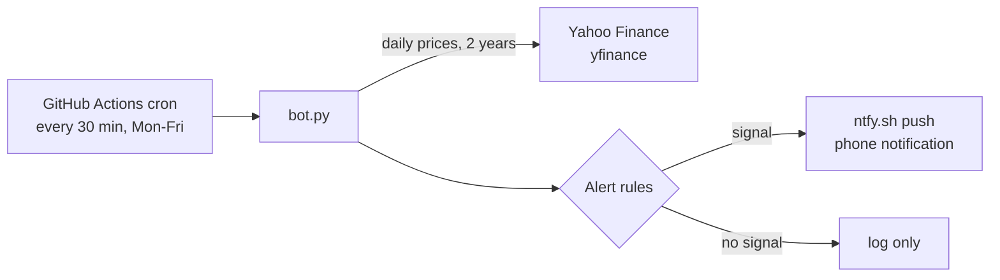

# BVB Market Alert Bot

[](https://github.com/alexandra10zam/BOT-BVB/actions/workflows/ci.yml)


A small Python bot that watches stocks and ETFs on the **Bucharest Stock Exchange (BVB)** and sends a **push notification to my phone** when a buy signal or a sudden drop appears. It currently tracks **Banca Transilvania (TLV)** and the **Patria-Tradeville energy ETF (PTENGETF)**.

It runs **serverless on a GitHub Actions schedule** during trading hours, so no machine has to stay on.

## How it works



Each run does a **single check** (no long-running loop) and applies two rules per symbol, with different thresholds for each:

| Rule | TLV | PTENGETF |
|---|---|---|
| **Drawdown buy signal:** price is X% below its 12-month high **and** below its 200-day moving average | 15% | 10% |
| **Sudden drop:** the price falls more than Y% in one day | 5% | 3% |

Thresholds live in the `SIMBOLURI` config dictionary, so adding a new symbol is a single new entry.

## Project structure

| File | Purpose |
|---|---|
| `bot.py` | Fetches prices, evaluates the rules, sends the notification |
| `backtest_ptengetf.py` | Replays the rules day by day over the last year of PTENGETF data to see how often they would have fired |
| `tests/` | Unit tests for the alert rules on synthetic price series (no network needed) |
| `.github/workflows/ci.yml` | Runs the tests on every push |
| `.github/workflows/alerts.yml` | Scheduled run during BVB trading hours (07:00-16:00 UTC) |

## Run it

```bash
pip install -r requirements.txt
export NTFY_TOPIC="your-private-topic"   # Windows: setx NTFY_TOPIC "your-private-topic"
python bot.py                            # one check
python backtest_ptengetf.py              # backtest over the last year
pytest                                   # unit tests
```

If `NTFY_TOPIC` is not set, the bot prints the alert instead of sending it.

**Run it in the cloud (GitHub Actions):**
1. In *Settings → Secrets and variables → Actions*, add a **secret** `NTFY_TOPIC`.
2. Add a **variable** `ALERTS_ENABLED` = `true`.
3. Subscribe to the same topic in the [ntfy](https://ntfy.sh) app.

## Tech

Python · pandas · yfinance · requests · ntfy.sh · pytest · GitHub Actions (CI + cron)

> The notification text is in Romanian. This is a personal monitoring tool, not investment advice.
